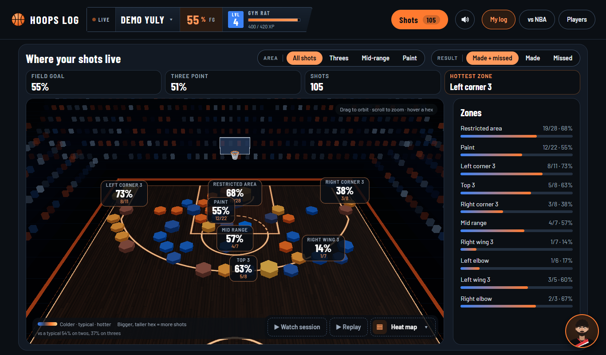
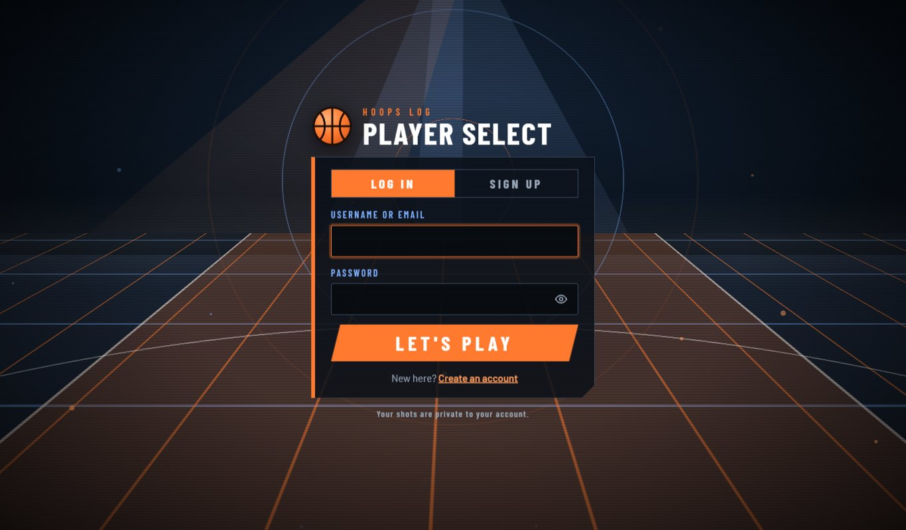
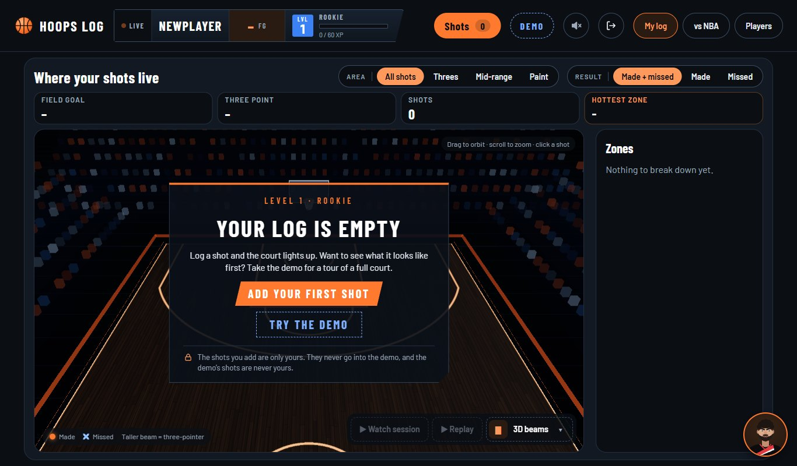
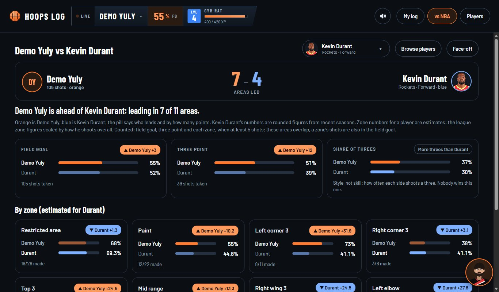
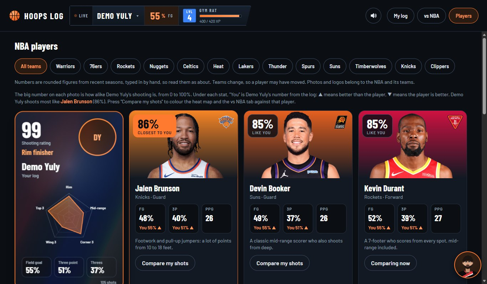
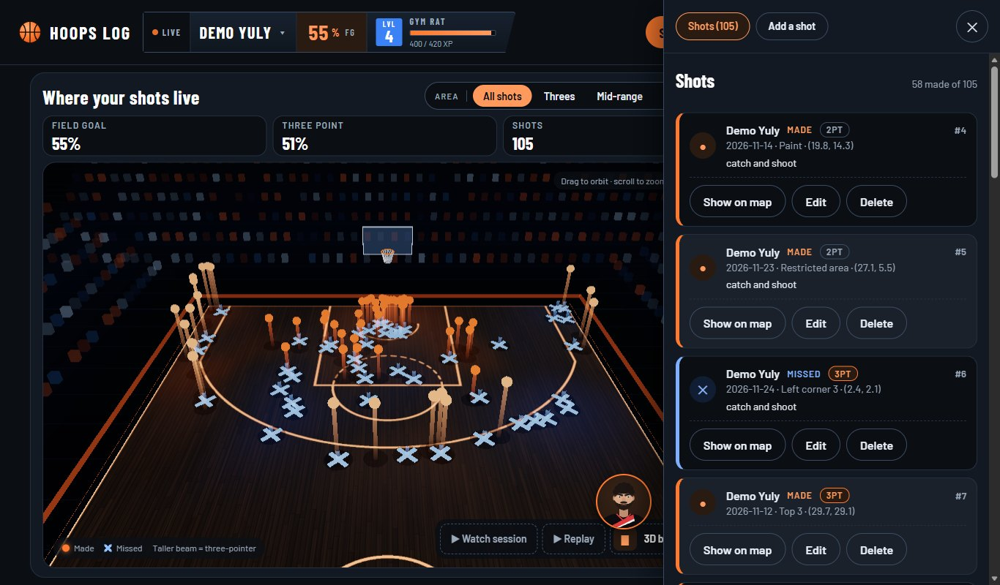
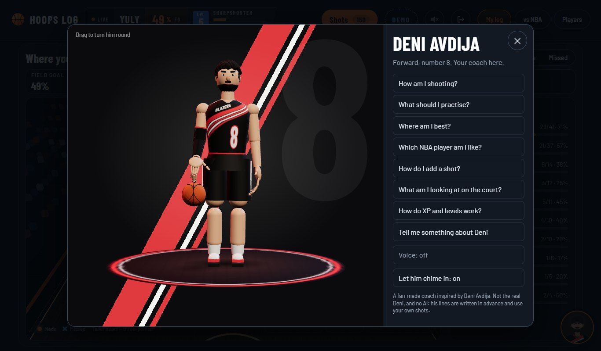
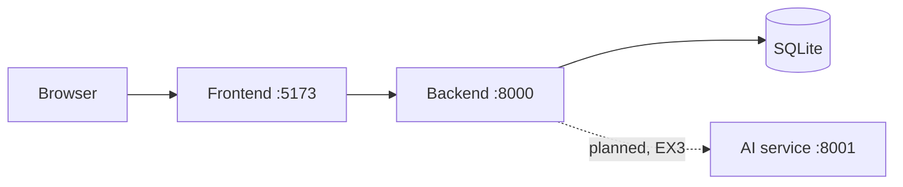

# Hoops Log

[](https://github.com/EASS-PART-A-2026-X/hoops-log/actions/workflows/ci.yml)
[](https://github.com/EASS-PART-A-2026-X/hoops-log/actions/workflows/e2e.yml)
[](https://github.com/EASS-PART-A-2026-X/hoops-log/tree/ex1)
[](https://github.com/EASS-PART-A-2026-X/hoops-log/tree/ex2)
[](https://github.com/EASS-PART-A-2026-X/hoops-log/tags)


A shot chart for basketball players and coaches: log your shots, see where you score, and compare yourself with NBA players. A FastAPI backend stores the shots; a React app draws them on a 3D court.



[Run it](#run-it) · [The app](#the-app) · [Endpoints](#endpoints) · [Security](#accounts-and-security) · [Tests](#test) · [How I know the tests are good](#how-i-know-the-tests-are-good) · [AI use](#ai-use) · [Open-source contributions](#open-source-contributions)

**Course checklist**
- [x] **EX1, backend:** CRUD API with validation, SQLite that survives restarts, Docker, and tests with a mutation score ([how I know the tests are good](#how-i-know-the-tests-are-good))
- [x] **EX2, frontend:** React app on the same API with accounts (log in and sign up), loading, empty and error states, a built-in demo, unit tests and a real-browser suite that also runs every night ([frontend/README.md](frontend/README.md))
- [ ] **EX3, AI service and operations:** planned (recap to shots, Compose, failure tests, release)

## Run it
Two programs run at once, each in its own terminal. You need [uv](https://docs.astral.sh/uv/) (0.12 or newer; it installs Python 3.14 for you) and Node 24 or newer.

```bash
cd backend && uv run fastapi dev          # API on http://localhost:8000
cd frontend && npm install && npm run dev # app on http://localhost:5173
```

Open http://localhost:5173, press START, then sign up (email, username, password, typed twice). A new account starts with no shots: add one, or press **DEMO** to see a full court with made-up shots. Shots live in SQLite (`backend/data/app.db`, git-ignored), so they survive a restart. The frontend's own README covers its settings, the tests and the browser tests ([frontend/README.md](frontend/README.md)).

Interactive API docs: http://localhost:8000/docs

### Backend only, with Docker
Stop `fastapi dev` first (Ctrl+C): if it still holds port 8000, `curl` reaches it instead of the container. Run these from `backend/`.

```bash
docker build -t hoops-log-backend .
docker run -d --name backend -p 127.0.0.1:8000:8000 -v backend-data:/app/data hoops-log-backend
curl -sS --retry 10 --retry-all-errors --retry-delay 1 localhost:8000/health   # {"status":"ok"}
```

The named volume holds the database, so shots survive `docker rm -f backend` and a new `docker run` with the same `-v`. Without it a new container starts empty (no accounts, no shots). `docker volume rm backend-data` deletes the data. Settings are environment variables (see `backend/.env.example`): set them in the shell, or with `docker run -e`.

| Variable | Default | Meaning |
|---|---|---|
| `DATABASE_URL` | `sqlite:///./data/app.db` | Where the SQLite file lives. |
| `FRONTEND_ORIGINS` | `http://localhost:5173,http://127.0.0.1:5173` | The page addresses (comma separated) allowed to call the API from a browser. Set it to the real address when deployed. |
| `LOGIN_ATTEMPTS` | `30` | Login tries per address in 5 minutes. |
| `LOGIN_FAILURES` | `8` | Failed logins per address and account in 5 minutes. |
| `REGISTER_ATTEMPTS` | `10` | Sign-ups per address per hour. |

## The app
Screenshots use generated demo shots, not real games.

| | |
|---|---|
| <br>**Log in or sign up**: after PRESS START, with an eye to show the password. | <br>**A new account** starts empty: add a shot, or try the demo. Its shots are only its own. |
| <br>**vs NBA**: you against the league average or a chosen player. | <br>**Players**: who shoots most like you, and your own shot card. |
| <br>**Shots**: the list and add form in a drawer, next to the 3D beams view. | <br>**Deni**: a scripted coach who answers from your own shots (no AI yet). |

## What it is
**Purpose:** shots recorded in notes apps and chat messages cannot be mapped or compared, so players never see where they are actually efficient.
**Operational principle:** after a player logs shots (with the add-shot form, or from EX3 by pasting a recap and confirming the proposed shots), the shots are saved and the chart shows made and missed shots by court position and zone; after a restart the same chart is still there.

User stories:
1. As a player, I can log a shot (where, made or missed) so that my chart builds up over time.
2. As a player, I can see my shots and zone percentages on the court and compare them with NBA players.
3. As a player, I log in with my own account so that nobody else can see, change or delete my shots. They are always under my username.
4. As a new player with no shots, I can open a demo of made-up shots to see what a full court looks like, and I am told my own shots never go into it.
5. EX3: as a player, I can paste a messy recap ("missed a corner three, then hit a pull-up from the left elbow"), review the proposed shots and save them.
6. EX3: as a player, I can ask "where should I shoot more?" and get advice backed by my own numbers.

### Data
Shot: x (float, 0-50 ft), y (float, 0-47 ft), made (bool), game_date (date, at most one day ahead of the server's date to allow for time zones), note (text, max 200). The player is the account's username: the server fills it in, and a client can never send it.

The backend computes two more fields; a client can never send them:
- **zone**: left_corner_3, left_wing_3, top_3, right_wing_3, right_corner_3, left_elbow, right_elbow, mid_range, paint or restricted_area
- **shot_type**: 2PT or 3PT, from the distance between x, y and the hoop

Court rules: NBA half court, 50 ft wide × 47 ft deep, origin at the left baseline corner, hoop at (25, 5.25). The 3PT line is 22 ft from the hoop in the corners (up to where the straight line meets the arc, about 14 ft from the baseline) and 23.75 ft on the arc.

### How the parts fit

Only the backend touches the database, and every request but sign-up, login and `/health` carries a login token. The AI service will be a separate, stateless service (FastAPI + Pydantic AI) that only reads free text: it turns a recap into shot proposals, which the user confirms before anything is saved. Counting, zones and geometry stay plain backend code. If it is down, logging shots still works.

### Endpoints
Every route needs `Authorization: Bearer <token>` (a missing or bad token is a 401), except `/health`, `/auth/register` and `/auth/login`. (The documentation pages `/docs`, `/redoc` and `/openapi.json` are open too: they show the API's shape, not data.) You only ever see your own shots: someone else's id is a 404, the same as a missing one.

| Request | What it does | Success |
|---|---|---|
| `GET /shots?offset=0&limit=50` | List a page (limit at most 100, offset at most 2147483647) | 200, or 422 if `limit` or `offset` is invalid or out of range |
| `POST /shots` | Create a shot (`x`, `y`, `made`, optional `game_date` and `note`). The player is your username, so sending a `player` is a 422 | 201 |
| `GET /shots/{id}` | Read one (ids start at 1) | 200, 404, or 422 if the id is below 1 or above 2147483647 |
| `PATCH /shots/{id}` | Change only the fields sent (`null` means unchanged) | 200, 404, or 422 (bad body, or an id below 1 or above 2147483647) |
| `DELETE /shots/{id}` | Delete one | 204, 404, or 422 if the id is below 1 or above 2147483647 |
| `GET /chart.svg?player=Name` | Shot chart as an SVG image (green circle = made, red cross = missed); `player` is optional. Letter case and spaces around the name are ignored, so `yuly` and `Yuly` are the same player | 200, or 422 if `player` is empty or longer than 50 characters |
| `POST /auth/register` | Make an account (`email`, `username`, `password`, `password_confirm`) and log in; returns `{token, user}` | 201, 409 if the email or username is taken, 422, 429 |
| `POST /auth/login` | Log in with a username or an email and a password; returns `{token, user}` | 200, 401, 429 |
| `GET /auth/me` | Who the token belongs to | 200 |
| `POST /auth/logout` | End this login at once | 204 |
| `GET /demo/shots` | The built-in demo: 150 made-up shots (negative ids, the same every time, never stored and never mixed with your own) | 200 |
| `GET /health` | Liveness check, returns `{"status":"ok"}` | 200 |

```bash
curl -i --json '{"x":1.5,"y":4,"made":false}' -H "Authorization: Bearer $TOKEN" localhost:8000/shots
# 201: zone "left_corner_3" and shot_type "3PT" are computed from x, y, and player is your username
```

## Accounts and security
Every shot belongs to an account. You sign up with an email, a username and a password (typed twice), the backend gives you a login token, and the browser sends it with every request. Nobody can see, change, delete or draw another account's shots.

| What could go wrong | What stops it |
|---|---|
| A stranger calls the API with `curl` | Every route except `/health`, `/auth/register` and `/auth/login` answers 401 without a valid token (the `/docs`, `/redoc` and `/openapi.json` pages show the API's shape and hold no data). A test fails if a route is added without the lock. |
| Someone steals the database file | Passwords are stored only as salted scrypt hashes (a new random salt each, 16 MB of memory per guess), tokens only as SHA-256 hashes. Nothing in the file logs anyone in. |
| Someone guesses passwords | Rate limits per address (all attempts, and failed attempts per account). An unknown user and a wrong password get the same answer and take the same time. Passwords are 10 to 128 characters and not a common one. |
| One user reads or edits another's shots, or logs a shot as someone else | A shot has an owner and the server puts the account's username on it; a `player` in the request is refused. Someone else's shot is a 404, the same as a missing one, so ids cannot be probed. The client can never send an `owner_id`. |
| A token is stolen or forgotten | Tokens are 32 random bytes, last 7 days, at most 10 per user, and `POST /auth/logout` ends one at once. |
| A token leaks through an address | It is only accepted in the `Authorization` header, never in the URL. Login answers are marked `no-store`. |
| Another website tries to use your login | CORS names the exact frontend addresses. The token is not a cookie, so there is no CSRF. |
| Strange input | Every field has a length and character check. Tests send SQL, scripts, emoji and Hebrew to every field. |

**How it works.** `POST /auth/register` and `POST /auth/login` return `{token, user}`. The frontend keeps the token in `localStorage`, sends it as `Authorization: Bearer <token>`, and asks `/auth/me` on load to check it still works. When a request gets a 401, the login screen opens over the app, so a half-typed shot is not lost. The code is in `backend/app/` (`security.py` for passwords, tokens and limits, `deps.py` for the lock, `routers/auth.py` for the routes) and `frontend/src/auth/`.

**Not covered yet.**
- **HTTPS.** Run locally, the token travels as plain HTTP. A deployed app must sit behind HTTPS, and a section on that comes with the deployment.
- The email is not verified and there is no password reset (both need an email service).
- Sign-up says when an email or username is already used, so someone can find out whether an address has an account (login never says which part was wrong). Sign-up is rate-limited to slow that down.
- A token in `localStorage` can be read by a script injected into the page. React escapes everything it draws, and the browser tests try HTML in names.
- The rate limits live in memory, per process: with several workers each counts on its own. Behind a reverse proxy, start the server with `--proxy-headers` and `--forwarded-allow-ips` set to the proxy's address, or every visitor shares one limit.
- Logging out while the server cannot be reached forgets the token on this device only; it stays valid on the server for up to 7 days. Logging out again once the server is back ends it at once.
- Shots saved before accounts existed stay in the database file and belong to nobody: no account sees them and nothing deletes them.

## Test
Backend, from `backend/`:

```bash
uv run pytest
uv run ruff check .
uv run ruff format --check .
```

Frontend, from `frontend/`: `npm run lint`, `npm test` and `npm run build`, plus `npm run e2e` for the real-browser tests (see the frontend README).

`tests/test_shots.py` starts with a testing-strategy comment listing every input partition; each test fixes one of them. `tests/test_court.py` checks the zone and 2PT/3PT rules. `tests/test_demo.py` checks the built-in demo (150 made-up shots, never stored). `tests/test_auth.py` and `tests/test_access.py` check sign-up, login and tokens, that every route is locked (a test fails if one is added without the lock) and that each account sees only its own shots. `tests/test_restart.py` checks a shot is still there after the server restarts on the same database file. The other tests use a fresh in-memory database each.

## How I know the tests are good
Passing tests only show that the cases I thought of work. Three checks go further, and all of them run from a fresh clone with `uv` (and Docker for the last step).

**Mutation score.** `scripts/mutation_score.py` changes one thing at a time in `app/` (`<` to `<=`, `and` to `or`, `50` to `51`) and runs the tests; a change no test notices is a survivor. My first run scored 68.6%, mostly because the chart tests checked structure and not coordinates. After adding tests it scores 100%. The few changes that cannot alter behaviour are marked `# equivalent-mutant: <why>` in the code instead of being hidden.

```bash
cd backend && uv run python ../scripts/mutation_score.py   # about 40 s
```

**A second agent that tries to break it.** `.claude/agents/breaker.md` starts with no memory of how the code was built and may only use this README and `/openapi.json`. Its first round found five bugs that my 141 tests missed, four in EX1 code that was already merged: `NaN` or `1e999` as `x`, a 20-digit id or offset, a lone surrogate in `player`, and a control character that made `/chart.svg` invalid XML (the player is now the account's username, limited to letters, digits and `_ . -`, so those last two cannot happen any more). All of them were 500s or broken output and are 422s now. Its 19 failing tests are permanent tests in `backend/tests/adversarial/`. The full log, including what it tried that was fine, is in [docs/adversarial-log.md](docs/adversarial-log.md).

**One command before merging.** `scripts/ci.sh` runs ruff, pytest and the mutation score (at least 95%) and the frontend checks. With `--docker` it also checks that a shot survives `docker rm -f` plus a new `docker run` on the same volume, and runs a kill test: shots are posted in a loop, the container is `SIGKILL`ed at a random moment, and every shot the API acknowledged with 201 must still be there after the restart. `.githooks/pre-push` runs the quick version (turn it on with `git config core.hooksPath .githooks`), and GitHub runs the full one on every pull request.

The checks found problems in their own tooling too: the first kill test reported 22 lost writes, which was my checker reading only the first 100 of 118 shots, not a lost write.

## API requests and results
Six requests (each logged in, with a token), with the status code and the stage of FastAPI's pipeline that answers (1 route match, 2 JSON parse, 3 input validation, 4 my handler, 5 response).

| # | Request | Result | Stage | Why |
|---|---|---|---|---|
| 1 | `POST /shots` `{"x":15,"y":19,"made":true}` (logged in) | 201 | 5 | Valid; the body has an `id`, your username as `player`, `zone` "left_elbow", `shot_type` "2PT" |
| 2 | `GET /shots/999` | 404 `{"detail":"Shot not found"}` | 4 | The route matched and my handler ran; the id does not exist |
| 3 | `POST /shots` `{"x":51}` (logged in) | 422, 3 errors | 3 | `x` over 50, `y` and `made` missing; all reported at once, handler never ran |
| 4 | `PATCH /shots/999` `{"x":51}` | 422, 1 error | 3 | `x` over 50; validation runs before the handler, so the missing id is never checked |
| 5 | `GET /shot/1` (typo) | 404 `{"detail":"Not Found"}` | 1 | No route matched; none of my code ran |
| 6 | `DELETE /shots/1` twice | 204, then 404 | 5, then 4 | The first call deletes; the second finds nothing |

## AI use
I used Claude Code (Opus 5.5 and Sonnet 5.5) for most of the typing: the models, court geometry, routes and tests, the SQLModel and Docker work, the chart, the mutation runner, the kill test, the breaker agent, the frontend, the accounts and login tokens, the demo, and drafts of this README. The babel fix (#18424) I traced with it and then reviewed line by line.

What I checked myself: every status code in the table above with `curl`; that tests fail when I break the code on purpose (`commit()` to `flush()`, for example); the Docker volume test by hand; each bug the breaker reported, reproduced before I accepted it. The frontend was merged by pull request after a separate review agent commented on it, and I used it in a real browser before saying it worked.

## Open-source shortlist
| Repository | Stars (date checked) | License | CONTRIBUTING | Why it fits me |
|---|---|---|---|---|
| [udecode/plate](https://github.com/udecode/plate) | 16.7k (24 Oct 2026) | MIT | [CONTRIBUTING.md](https://github.com/udecode/plate/blob/main/CONTRIBUTING.md) | React/TS editor; I already have five merged PRs on main (docs, docx-io, two markdown fixes, yjs peer range) |
| [maplibre/maplibre-gl-js](https://github.com/maplibre/maplibre-gl-js) | 11.9k (24 Oct 2026) | BSD-3-Clause | [CONTRIBUTING.md](https://github.com/maplibre/maplibre-gl-js/blob/main/CONTRIBUTING.md) | TypeScript map renderer; I already have a merged bug fix on main |
| [babel/babel](https://github.com/babel/babel) | 44.1k (26 Oct 2026) | MIT | [CONTRIBUTING.md](https://github.com/babel/babel/blob/main/CONTRIBUTING.md) | JavaScript/TypeScript compiler; I already have a merged generator bug fix on main |

## Open-source contributions
Student: Yuly Cohen ([@yulman2207](https://github.com/yulman2207))

| # | Repository | License | Stars (date checked) | PR | Contribution summary | Merge evidence (landed on main) |
|---|---|---|---|---|---|---|
| 1 | [udecode/plate](https://github.com/udecode/plate) | [MIT](https://github.com/udecode/plate/blob/main/LICENSE) | 16.7k (22 Oct 2026) | [#5219](https://github.com/udecode/plate/pull/5219) | Fixed the Next.js guide: it read `localStorage` during server render and crashed with `localStorage is not defined`; the example now restores the saved value in a `useEffect` after mount (#5153). | merged into `main` by zbeyens on 20 Oct 2026 (merge commit): [commit ffb2807](https://github.com/udecode/plate/commit/ffb28077a40e82ee07fff468da99b03c65693410), [PR page](https://github.com/udecode/plate/pull/5219) |
| 2 | [udecode/plate](https://github.com/udecode/plate) | [MIT](https://github.com/udecode/plate/blob/main/LICENSE) | 16.7k (22 Oct 2026) | [#5232](https://github.com/udecode/plate/pull/5232) | Fixed DOCX export dropping tables nested inside table cells: the exporter now builds a nested table with `buildTable`, at any depth, and I added a test (#5192). | squash-merged into `main` by zbeyens on 22 Oct 2026: [commit b3c826e](https://github.com/udecode/plate/commit/b3c826ee68af1e28472e29fef0d71a742f0c9b42), [PR page](https://github.com/udecode/plate/pull/5232) |
| 3 | [maplibre/maplibre-gl-js](https://github.com/maplibre/maplibre-gl-js) | [BSD-3-Clause](https://github.com/maplibre/maplibre-gl-js/blob/main/LICENSE.txt) | 11.9k (22 Oct 2026) | [#8847](https://github.com/maplibre/maplibre-gl-js/pull/8847) | Fixed a `TypeError` in `CrossFadedConstantBinder` when dash positions were never set: `dashFrom`/`dashTo` are now initialised to `null` like the pattern fields (#8846). | squash-merged into `main` by HarelM on 22 Oct 2026: [commit 0391300](https://github.com/maplibre/maplibre-gl-js/commit/03913009ee17311cead1afe55919589d4ed72988), [PR page](https://github.com/maplibre/maplibre-gl-js/pull/8847) |
| 4 | [babel/babel](https://github.com/babel/babel) | [MIT](https://github.com/babel/babel/blob/main/LICENSE) | 44.1k (26 Oct 2026) | [#18424](https://github.com/babel/babel/pull/18424) | Fixed the generator dropping parentheses around a TypeScript instantiation expression operand: `(f \|\| g)<string>` was printed as `f \|\| g<string>`, which changes what the code means. `hasPostfixPart` now treats the operand of a `TSInstantiationExpression` as a postfix position, and I added a fixture covering operands that need and don't need parentheses (#18358). | squash-merged into `main` by nicolo-ribaudo on 26 Oct 2026: [commit 1c0bea6](https://github.com/babel/babel/commit/1c0bea6825097075fa8fda58f9c2136c2db4a4aa), [PR page](https://github.com/babel/babel/pull/18424) |
| 5 | [udecode/plate](https://github.com/udecode/plate) | [MIT](https://github.com/udecode/plate/blob/main/LICENSE) | 16.7k (4 Nov 2026) | [#5328](https://github.com/udecode/plate/pull/5328) | Fixed `deserializeMd` leaving a trailing `\r` on every line of a fenced code block with CRLF line endings, so `serializeMd` wrote CRLF inside an LF fence: the `code_block` rule now splits on `\r\n`, `\r` or `\n`, so CRLF and CR input give the same result as LF, and I added a spec for it (#5322). | squash-merged into `main` by zbeyens on 4 Nov 2026: [commit b9de659](https://github.com/udecode/plate/commit/b9de659cf742e10154e17b44e72ef5e50dbc8613), [PR page](https://github.com/udecode/plate/pull/5328) |
| 6 | [udecode/plate](https://github.com/udecode/plate) | [MIT](https://github.com/udecode/plate/blob/main/LICENSE) | 16.7k (4 Nov 2026) | [#5329](https://github.com/udecode/plate/pull/5329) | Fixed `deserializeMd` dropping a soft line break right after a link, mark or inline code (`a [link](x)\nb` became `linkb`): the leading newline is now removed only after a `<br>` html node, which is the case the old strip was written for, and I added a spec (#5321). | squash-merged into `main` by zbeyens on 4 Nov 2026: [commit 9bfec80](https://github.com/udecode/plate/commit/9bfec80ea22b7fc6a28c5971b3adc27df15ca51a), [PR page](https://github.com/udecode/plate/pull/5329) |
| 7 | [udecode/plate](https://github.com/udecode/plate) | [MIT](https://github.com/udecode/plate/blob/main/LICENSE) | 16.7k (17 Nov 2026) | [#5338](https://github.com/udecode/plate/pull/5338) | Fixed `@platejs/yjs` reporting an unmet peer dependency next to the current `@hocuspocus/provider` 4.x: the peer range is now `^3.4.0 \|\| ^4.0.0`, so both majors install without a warning (#5337). I checked the existing tests and typecheck on both versions and ran the real provider wrapper against a local server to confirm that two clients sync. | squash-merged into `main` by zbeyens on 11 Nov 2026: [commit 82b89b9](https://github.com/udecode/plate/commit/82b89b9c6132ddf46d6301590402f29966fead15), [PR page](https://github.com/udecode/plate/pull/5338) |
