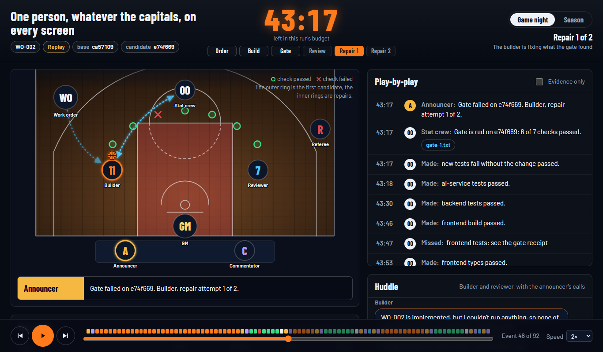
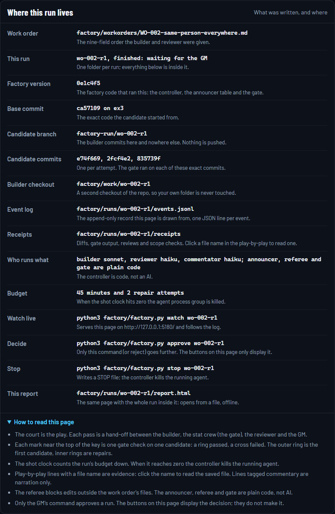
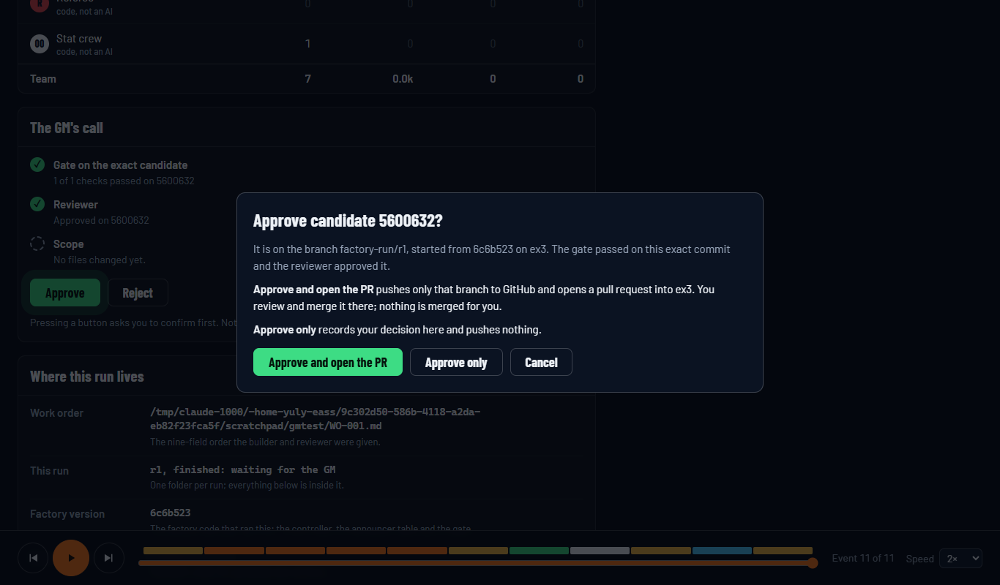
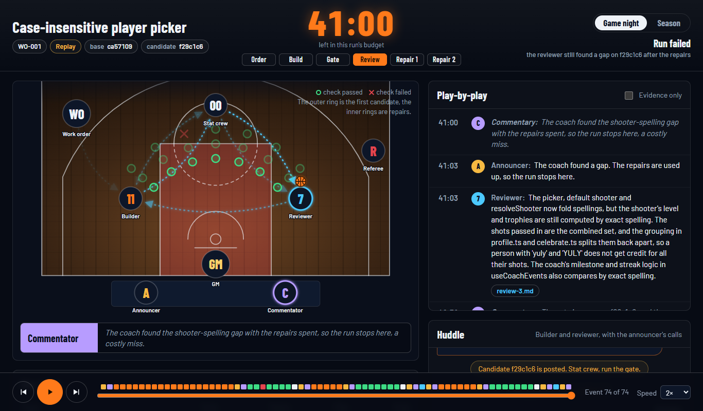
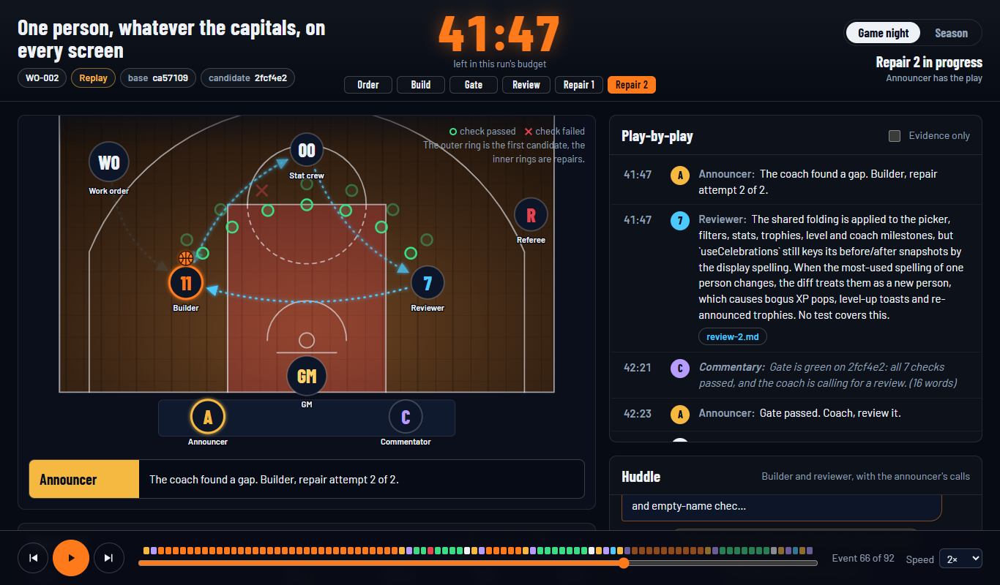
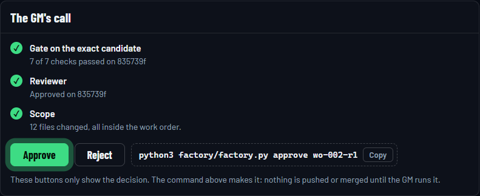

# The software factory

A factory that turns a **work order** into a **checked candidate change**, and then stops and waits for a
human. Nothing it makes is merged, pushed or released until the person in charge (the "GM") decides: with the
Approve button on the live page (after a confirmation) or with one command.



The picture is the live page of a real run (WO-002). The court is the play: each pass is a hand-off, each
ring or cross is one gate check on one candidate.

## The idea in one minute

```
work order (9 fields) ─► controller records the base commit
   ─► BUILDER edits code in its own checkout          (AI, no shell, an edit hook)
   ─► controller checks which files changed; reverts the rest
   ─► controller commits ONE candidate
   ─► GATE: the checks run on a clean checkout of that exact commit   (code, not an AI)
         red?   ─► repair (at most 2) or stop
         green? ─► REVIEWER reads the diff and the code, read only    (a separate AI process)
                    gap?      ─► repair (at most 2) or stop
                    approved? ─► ready: waiting for the GM
   ─► the GM decides on the live page, or with `factory approve`  (only this goes further)
```

The controller and the announcer that decides who goes next are **plain Python**, not an AI. An AI that decides
the order could skip the gate or loop forever, and a replay would never be the same twice. The AI roles only
write code, review code, and narrate.

## Who is who

| Role | What it is | What it can do |
|---|---|---|
| Controller | code (`factory_lib/controller.py`) | owns the clock, the folders, the commits and the checks |
| Announcer | code (`announcer.py`, a fixed table) | says who is up next; the next agent hears it in its prompt |
| Referee | code (`hooks/scope_guard.py`, `scope.py`) | blocks and reverts edits outside the work order's files |
| Stat crew (the gate) | code (`gate.py`) | runs the checks on the exact candidate; never an agent |
| Builder | `claude -p` (Sonnet) | read, search, edit, write files. **No shell.** |
| Reviewer | a separate `claude -p` (Haiku) | read only. Cannot change what it reviews |
| Commentator | `claude -p` (Haiku), optional | one sentence of narration; decides nothing; labelled *commentary, not evidence* |
| GM | you | the Approve / Reject buttons on the live page, or `factory approve` / `factory reject` |

## Enforced, or only advice?

The course asks to say which rules the system really enforces. Here is the honest list.

| Rule | Enforced by | Is it a real fence? |
|---|---|---|
| The builder has no shell | `--tools Read,Glob,Grep,Edit,Write`: the tool is not available | **Yes.** See the experiment below |
| Edits only to the work order's `Files` | an edit hook before every Edit/Write, *and* the controller reverts anything else after the builder stops | **Yes**, twice. The hook fails closed |
| The gate runs on the exact candidate | a clean checkout of the commit, made by the controller | **Yes** |
| The new tests must fail without the change | the gate's `fails-first` check runs them on the original code | **Yes** |
| Time is limited; STOP works | the controller owns the process group and kills it (`runner.py`) | **Yes**: a real kill, not a message |
| Nothing is pushed or merged | no push code on the run path; only a decision by a person (the page's "Approve and open the PR" after a confirmation, or `factory approve --open-pr`) | **Yes** by construction; **not** by GitHub (`main` and `ex3` have no branch protection) |
| Only the page the server gave you can decide | the server (`127.0.0.1` only) puts a secret token in the page it serves and checks it, the Host and the Origin on every decision | **Yes**: another website, or a copy of the page, cannot decide |
| "Do not use git", "keep the change small" | the builder's prompt | **Advice only** |
| The reviewer's verdict | a small model's reading | **Evidence, not proof** |

**The experiment that shaped the design.** First version: `--allowedTools Read Edit Write`. A test asked the
model to write a forbidden file, and it wrote it through **Bash**; the edit hook never fired, because Bash was
still available. An allow-list in a flag is guidance. Removing the tool with `--tools` is the fence. This is
the course's point that guidance is not enforcement, found by running it.

What a worktree is **not**: it separates edited files, not processes or credentials. The builder runs as you.
It cannot push because it has no shell and no push code, not because it is sandboxed. A container would add real
isolation; this version does not have one.

## What is written where

```
factory/
  README.md                      this file
  factory.py                     the command line: run | watch | status | stop | approve | reject | export
  factory_lib/                   controller, announcer, gate, scope, agents, runner, events, report, serve
  hooks/scope_guard.py           the edit hook the builder runs under
  workorders/                    WO-001 and WO-002: the nine-field orders
  dashboard/                     dashboard.template.html (source) and dashboard.html (built, fonts embedded)
  tests/                         the factory's own tests (no model is ever called)
  runs/<run-id>/                 ONE FOLDER PER RUN (committed as evidence)
      run.json                   the summary: status, base commit, candidates, models, where everything is
      events.jsonl               the append-only log: one JSON line per event. The page is drawn from this
      receipts/                  work-order.md, builder-N-summary/tools, scope-check-N, commit-N, diff-N,
                                 gate-N (every check, and the output of failed ones), review-N
      candidate.patch            the final candidate against the base commit
      report.html                the page with the whole run inside it: opens from a file, offline
      index.html                 the live page (rebuilt by `watch`; not committed)
  work/                          the builder's checkout and the gate's scratch checkouts (not committed)
```

The candidate itself lives on a **local branch** `factory-run/<run-id>` (not pushed). `candidate.patch` has the
same change as text, so the evidence stands without the branch.

Every path above is also shown **inside the page**, in the panel "Where this run lives", together with the
exact commands to watch, stop and decide.



## The GM's call, from the page

`factory run` serves the live page itself and **keeps it up after the run until you decide**, so it never closes
before you can click. (`factory watch <run-id>` serves a finished or running run's page later.) When the run is
waiting for the GM, the panel *The GM's call* has real buttons:

- **Approve**: asks you to confirm first. *Approve and open the PR* pushes only that candidate branch and opens a
  pull request into the base, where you review and merge it. *Approve only* records the decision and pushes nothing.
- **Reject**: asks for an optional reason and records it. Nothing is pushed.



The buttons and `factory approve` call the same code (`factory_lib/decide.py`), so they cannot disagree. A run
can be decided once. An offline copy (`report.html` opened from a file) cannot decide: it shows the command.
If pushing fails (for example, no network), the approval stays recorded, the page says delivery failed, and
`factory approve <run-id> --open-pr` retries only the delivery.

## Run it

```bash
python3 factory/factory.py run factory/workorders/WO-002-same-person-everywhere.md   # a real run (uses your claude login);
                                                    # serves http://127.0.0.1:5180/ and waits there for your decision
python3 factory/factory.py watch wo-002-r1          # the same page for an existing run
python3 factory/factory.py status                   # every run; says "died" if a controller vanished
python3 factory/factory.py stop wo-002-r1           # kills the running agent's process group
python3 factory/factory.py approve wo-002-r1        # the GM's decision; add --open-pr to push the branch and open a PR
                                                    # (the page's buttons do the same)
python3 factory/factory.py reject wo-002-r1 --reason "too broad"
```

`--agents scripted` runs the same pipeline with scripted stand-ins (no model, no cost). The tests use only those,
and the page says **Scripted agents, not AI** when a run used them.

Port 5180 can be changed with `--serve-port` (0 = no page). Needs `claude` (Claude Code) on the PATH and a logged-in account; `git`; the frontend's `node_modules` for the
gate (the gate's checkouts share them through a symlink). `--builder-budget-usd` caps the builder's spend per
attempt.

## Two real runs

| | WO-001 | WO-002 |
|---|---|---|
| Work order | picker lists `yuly` and `YULY` as one person | the same person on every screen |
| Result | **stopped**: repairs used up | **waiting for the GM** |
| Candidates / repairs | 3 / 2 | 3 / 2 |
| Time | 4.0 minutes | 4.9 minutes |
| Builder | 33 turns, about 186k tokens, $0.84 | 55 turns, about 200k tokens, $0.96 |
| Fouls | 0 | 0 |
| Gate | red, green, green | red, green, green |

**WO-001 stopped, and that is the useful part.** The first review found real gaps (the map and its statistics,
the trophies and level, the coach's milestones, and a frontend `toLowerCase` where the backend uses case-folding).
They were in files the order did not allow the builder to touch. The builder said so ("`stats.ts` and
`ShotMap.tsx` aren't on the allowed list") and worked around it inside `App.tsx`; the next review found the rest.
**The contradiction was in my work order**: its review focus said "every place", its file list named five. The
stop rule worked as designed, and the fix was to write a better order, not to loosen the fence.



**WO-002** listed the files the findings named. The first gate went red (one old test expected the old rule),
the builder fixed it, the reviewer then caught that the celebration snapshots were still keyed by the display
spelling (so a person whose most-used spelling changes would get bogus XP pops), the builder fixed that, and the
reviewer approved. The candidate `835739f` changes 12 files (+138, -37), all inside the allowed list.





The full 27-second replay: [factory-run.mp4](../docs/factory/factory-run.mp4) (the README shows a GIF of its
first part).

**Decided.** The GM approved WO-002's candidate with `factory approve --open-pr`, which pushed only the branch
`factory-run/wo-002-r1` and opened a pull request into `ex3`. It is for review there; nothing was merged by the
factory.

## Limits, said plainly

- The gate runs the frontend checks (lint, types, unit tests, build), the backend and AI-service tests, and the
  fails-first check. It does **not** run the Playwright end-to-end tests: the rewritten pinned e2e test is only
  checked when GitHub CI runs it on a PR.
- The builder cannot run tests; it writes code from reading it. That costs repairs, and the real runs show it.
- The reviewer is a small model (Haiku). It found real gaps here, but a verdict is evidence, not proof.
- A passing gate shows the checks did not fail on those inputs. It is not a proof of correctness.
- The commentator's lines are narration. The page labels them, and "Evidence only" hides them.
- A worktree is not a sandbox (see above). There is no container.
- One commentary line in WO-002's log ends with a stray "(16 words)" that the small model added. It is kept
  as recorded; the factory now strips such lines.
- If a controller process is killed, `run.json` stays `running`; `factory status` shows `died`.

## Tests

`python3 -m pytest factory/tests` (also run by `scripts/ci.sh`): 101 tests, no model and no network. They
cover the announcer table, the scope rules, the hook (it fails closed), the process kill and the stop file, the
gate and the fails-first check, every path through the controller (good run, repairs, the repair limit, scope
violations, stop, out of time, a crash), and the GM commands. Each of the main rules was broken on purpose to see
that a test fails.
